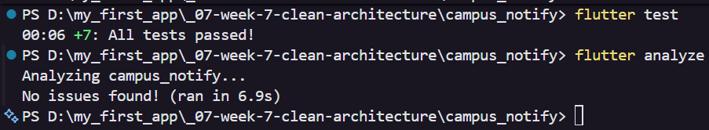

# Week 07 | Clean Architecture

## Audit Architecture

|File|Current Layer|Problem|
|---|---|---|
|lib/pages/*|Presentation|Callas API and format data|
|lib/providers/auth_provider.dart|Presentation|Instantiate manual without dependency injection|
|lib/data/auth_repository.dart|Data|Interface and implementation is still one|

---

## 1. Current Folder / Repository Structure

```text
lib/
├── core/
│   ├── failures.dart                                  # Pure Dart domain failures (Local, Network, Auth, Validation, NotFound)
│   ├── providers.dart                                 # Cross-feature providers (TokenStorage, Dio ApiClient, PushNotificationService)
│   ├── messaging/
│   │   ├── push_notification_service.dart             # PushNotificationService & NoopPushNotificationService interface
│   │   └── fcm_push_notification_service.dart         # FCM + Local Notification implementation
│   ├── network/
│   │   ├── token_refresher.dart                       # Token refresher interface (decoupling ApiClient from Auth)
│   │   └── api_client.dart                            # Dio client builder with auto-refresh token
│   ├── storage/
│   │   └── token_storage.dart                         # TokenStorage interface & FlutterSecureStorage implementation
│   └── widgets/
│       └── error_view.dart                            # Reusable error & retry widget
├── features/
│   ├── announcements/
│   │   ├── data/
│   │   │   ├── datasources/
│   │   │   │   └── announcement_remote_data_source.dart
│   │   │   ├── models/
│   │   │   │   └── announcement_model.dart
│   │   │   └── repositories/
│   │   │       └── announcement_repository_impl.dart
│   │   ├── domain/
│   │   │   ├── entities/
│   │   │   │   └── announcement.dart
│   │   │   ├── repositories/
│   │   │   │   └── announcement_repository.dart       # Repository interface
│   │   │   └── usecases/
│   │   │       ├── get_announcements.dart
│   │   │       └── get_announcement_detail.dart
│   │   └── presentation/
│   │       ├── pages/
│   │       │   ├── announcement_page.dart
│   │       │   └── home_page.dart
│   │       └── providers/
│   │           └── announcement_providers.dart        # Notifiers & DI for announcements
│   ├── auth/
│   │   ├── data/
│   │   │   ├── datasources/
│   │   │   │   └── auth_remote_data_source.dart       # Remote API contract & mock implementation
│   │   │   ├── models/
│   │   │   │   └── auth_session_model.dart            # JSON serialization model
│   │   │   └── repositories/
│   │   │       └── auth_repository_impl.dart
│   │   ├── domain/
│   │   │   ├── entities/
│   │   │   │   └── auth_session.dart                  # Pure Dart entity
│   │   │   ├── repositories/
│   │   │   │   └── auth_repository.dart               # Repository interface
│   │   │   └── usecases/
│   │   │       ├── check_auth_status.dart
│   │   │       ├── login_user.dart                    # Credential validation (business rule)
│   │   │       └── logout_user.dart
│   │   └── presentation/
│   │       ├── pages/
│   │       │   └── login_page.dart
│   │       └── providers/
│   │           └── auth_providers.dart                # AuthNotifier & DI for auth
│   └── notes/
│       ├── data/
│       │   ├── datasources/
│       │   │   └── notes_database.dart                # SQLite database provider (supports Mobile & Desktop FFI)
│       │   ├── models/
│       │   │   └── note_model.dart
│       │   └── repositories/
│       │       └── note_repository_impl.dart
│       ├── domain/
│       │   ├── entities/
│       │   │   └── note.dart                          # Pure Dart entity
│       │   ├── repositories/
│       │   │   └── note_repository.dart               # Repository interface
│       │   └── usecases/
│       │       ├── add_note.dart                      # Note input validation (business rule)
│       │       └── get_notes.dart
│       └── presentation/
│           ├── pages/
│           │   └── notes_page.dart
│           ├── providers/
│           │   └── notes_providers.dart               # Notifier & DI for notes
│           └── widgets/
│               ├── add_note_dialog.dart               # Note input dialog
│               └── notes_list.dart                    # Notes list widget
├── routes.dart                                        # GoRouter + route constants (AppRoutes)
└── main.dart                                          # Composition root (DI binding, safe platform init, runApp)
```

---

## 2. File Location Mapping (Old vs New)

| Old File | Status (Move / Split / Delete) | New File Destination | Reason |
|---|---|---|---|
| `lib/main.dart` | **Split** | • `lib/main.dart`<br>• `lib/routes.dart` | Separates app startup from route configuration (`GoRouter`). `main.dart` now acts only as the composition root (Single Responsibility Principle). |
| `lib/data/api_client.dart` | **Move / Split** | • `lib/core/network/api_client.dart`<br>• `lib/core/network/token_refresher.dart` | The HTTP client is used across multiple features, so it belongs in `core/`. Decoupled from the auth feature by introducing the `TokenRefresher` interface (Dependency Inversion Principle). |
| `lib/data/token_store.dart` | **Split** | • `lib/core/storage/token_storage.dart` | Put behind a `TokenStorage` interface so other classes depend on an abstraction rather than FlutterSecureStorage directly, making unit testing easy (DIP & LSP). |
| `lib/data/auth_repository.dart` | **Split** | • `lib/features/auth/domain/entities/auth_session.dart`<br>• `lib/features/auth/domain/repositories/auth_repository.dart`<br>• `lib/features/auth/data/models/auth_session_model.dart`<br>• `lib/features/auth/data/datasources/auth_remote_data_source.dart`<br>• `lib/features/auth/data/repositories/auth_repository_impl.dart`<br>• `lib/features/auth/domain/usecases/login_user.dart`<br>• `lib/features/auth/domain/usecases/logout_user.dart`<br>• `lib/features/auth/domain/usecases/check_auth_status.dart` | The old file mixed domain entities, repository contracts, implementation, data serialization, business validation, and mock networking into a single class. Split into Domain (entity, repository interface, use cases) and Data (model, data source, repository impl) layers (Clean Architecture & SRP). |
| `lib/providers/auth_provider.dart` | **Move / Split** | • `lib/features/auth/presentation/providers/auth_providers.dart` | Moved to the auth presentation layer. Instead of directly calling the repository and secure storage, the notifier now only calls domain use cases (`LoginUser`, `LogoutUser`, `CheckAuthStatus`). |
| `lib/pages/login_page.dart` | **Move** | • `lib/features/auth/presentation/pages/login_page.dart` | Moved into the feature-first folder (`features/auth/presentation/pages/`). Listens to use-case-driven state and displays domain `Failure` messages. |
| `lib/pages/home_page.dart` | **Split** | • `lib/features/announcements/presentation/pages/home_page.dart`<br>• `lib/features/announcements/data/datasources/announcement_remote_data_source.dart`<br>• `lib/features/announcements/domain/usecases/get_announcements.dart`<br>• `lib/features/announcements/presentation/providers/announcement_providers.dart` | Hardcoded announcement mock data was removed from the widget and moved into a remote data source. The page now only displays UI state received from the use case provider (SRP). |
| `lib/pages/announcement_page.dart` | **Move** | • `lib/features/announcements/presentation/pages/announcement_page.dart` | Moved into `features/announcements/presentation/pages/`. Now gets announcement details through the `GetAnnouncementDetail` use case instead of displaying static text. |
| `lib/messaging/push_service.dart` | **Split** | • `lib/core/messaging/push_notification_service.dart`<br>• `lib/core/messaging/fcm_push_notification_service.dart` | Loose top-level functions and mutable global variables (`pendingDeepLink`) were encapsulated behind a `PushNotificationService` interface and `FcmPushNotificationService` class. Added a `NoopPushNotificationService` fallback so the app does not crash on platforms without Firebase (Windows desktop/web). |
| `lib/features/notes/data/models/note_repository_impl.dart` *(starter)* | **Delete / Move** | • `lib/features/notes/data/repositories/note_repository_impl.dart` | Wrong initial folder placement (`data/models/`). Moved to `data/repositories/` to match clean architecture conventions. |
| `lib/features/notes/presentation/providers/notes_provider.dart` *(starter)* | **Delete / Move** | • `lib/features/notes/presentation/providers/notes_providers.dart` | Renamed to plural (`notes_providers.dart`) to match the project convention, and upgraded to an `AsyncNotifier` with an `add()` method that runs the `AddNote` use case. |
| `test/widget_test.dart` | **Delete** | • `test/features/auth/auth_usecases_test.dart`<br>• `test/features/notes/notes_usecases_test.dart`<br>• `test/app_widget_test.dart` | The default Flutter counter template test failed and was not relevant. Replaced with unit tests for domain use cases and a widget test for app startup. |



## Reflections

### 1. Why must the repository interface live in domain, not in data? What breaks if it is reversed?
It satisfies the Dependency Inversion Principle (DIP). The domain layer represents pure business rules and must remain independent of external frameworks, libraries, or data sources. If reversed if the interface lives in data, domain must import data. This reverses the dependency arrow, coupling core business logic directly to infrastructure concerns

### 2. When is a use case truly needed, and when is repository straight to notifier enough?
Used when executing actual business rules, orchestrating multiple repositories, coordinating transactions, applying complex validation/transformations, or sharing identical business logic across multiple notifiers/features. Notifier is enough when simple, single-source pass-through operations needed


### 3. What does over-engineering (a use case per one-line CRUD) cost a small team? When is the cost worth it?
Massive overhead, higher cognitive load navigating 4–6 files per trivial call, slower delivery velocity, and maintenance burden. It is worth it when domain complexity is high, business rules change frequently independent of the UI, multiple platforms/clients share the exact same domain code, or multiple teams need strict isolation boundaries to avoid merge conflicts.

### 4. Which part of the AI proposal did you reject or simplify, and why?
Use Case classes and separate Data-Transfer-Object (DTO) to Domain Entity mappers for simple read/write operations. AI architectural proposals routinely generate full boilerplate Clean Architecture for trivial endpoints