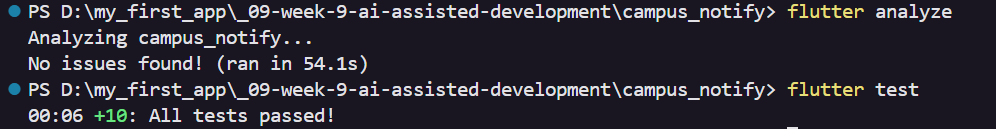

# Week 09 | AI-Assisted Development / Vibe Coding

## Reflections

1. Which AI hallucination did you find and how did you prove it?
Assuming StateProvider<String> was valid and available for managing search query state
When executing flutter test test/features/notes/notes_search_test.dart, the Flutter compiler failed

2. Which prompt helped most and what did you change?
"Limits: keep architecture, max 80 lines"
Instead of modifying the domain and data layers (which would require updating NoteRepository, GetNotes, SQLite queries, and mock repositories across 4+ files), we shifted the search logic entirely to the presentation layer via Riverpod's reactive computation

3. Which accept/reject decision was hardest?
Repository-level SQL Query or In-Memory Provider Filtering