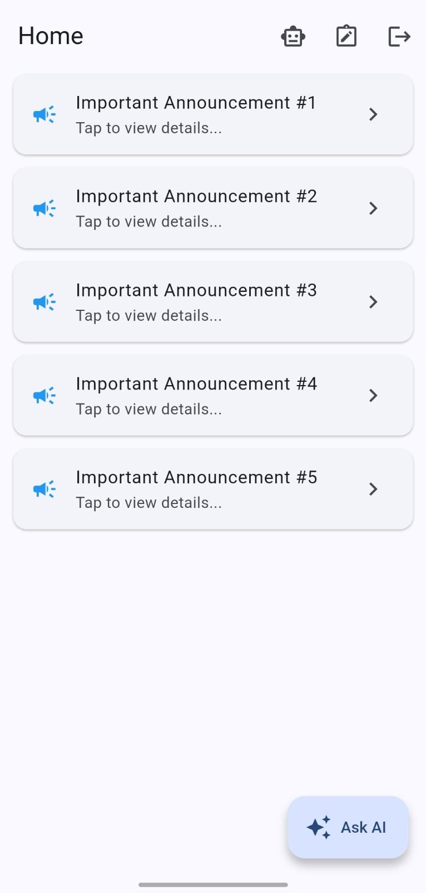
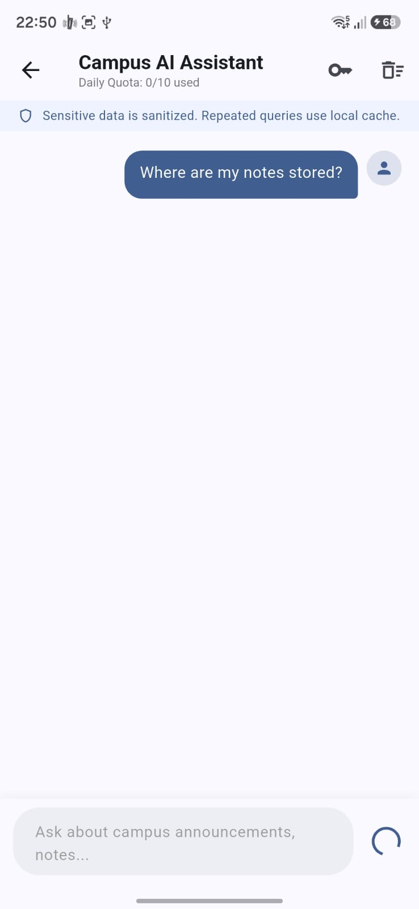
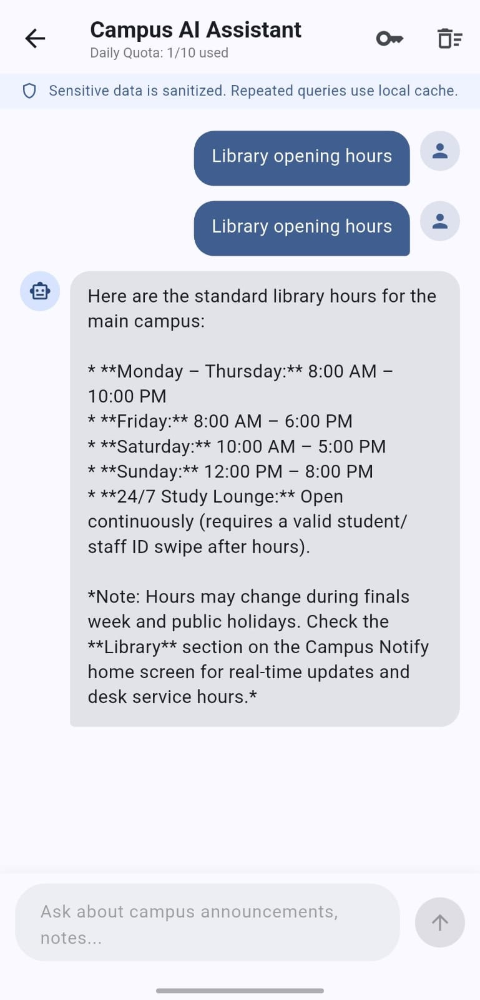

# Week 10 | AI Feature Integration

## Reflection
1. Which AI feature did you integrate and why?
The AI feature i integrate is ai chat assistant, because its the simplest and don't need any hardware permision

2. How do you protect user privacy when using AI API?
- The chat screen display "Sensitive data is sanitized. Repeated queries use local cache"
- The API key is stored with flutter_secure_storage and sent in a header, so it stays out of URLs and logs.
- The AI assistant uses its own independent HTTP client so the student's campus session JWT  is never transmitted to Google's cloud servers

3. What fallback do you provide if AI service errors?
- If the external cloud API is completely unreachable, the app gracefully switches to an internal campus fallback engine that answers common questions
- If the user asks a previously answered question while offline or during an API outage, it is served immediately without making a network call

4. One thing you learned about AI feature UX on mobile?
- On mobile devices, users frequently face spotty network connections and expect immediate feedback. Integrating cloud AI taught me that you cannot treat an AI API like a standard instant backend