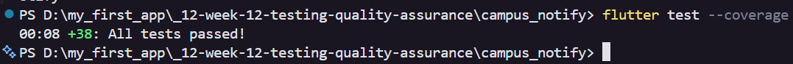
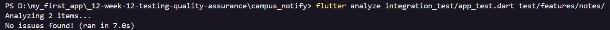
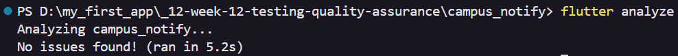

# Campus Notify — Week 12: Testing & Quality Assurance

---

## 1. Test Scenarios

### Unit Tests (`test/features/notes/notes_usecases_test.dart`)
- **Empty / Whitespace Title (Invalid Input)**: `AddNote` rejects `""` and `"   "` with `ValidationFailure('Title is required')` without calling `NoteRepository.addNote`.
- **Title Max Length Boundary (Edge Case)**:
  - Rejects titles exceeding `AddNote.maxTitleLength` (101 characters) with `ValidationFailure`.
  - Accepts titles of exactly `AddNote.maxTitleLength` (100 characters).
- **Input Trimming & Save (Happy Path)**: `AddNote` trims leading/trailing whitespace on `title` and `body` and persists the note via `FakeNoteRepository`.
- **Repository Write Failure (Error Case)**: `AddNote` propagates `LocalFailure('db write failed')` when `FakeNoteRepository.failNext` is `true`.
- **Fetch Stored Notes & Read Failure**: `GetNotes` returns stored notes on success and propagates `LocalFailure` on repository failure.

### Widget Tests (`test/features/notes/notes_page_test.dart` & `test/features/notes/notes_search_test.dart`)
- **Initial Display**: `NotesPage` renders `'My Notes'` title, search field (`notes_search_field`), add FAB (`add_note_fab`), and `'No notes yet.'` empty state.
- **Loading State**: Displays `CircularProgressIndicator` while `fetchNotes()` is pending (controlled via `Completer`, without `Future.delayed`).
- **Error State & Retry**: Displays `'Failed to load notes'` and a `Retry` button when `fetchNotes()` fails; tapping `Retry` reloads and renders the notes once the repository recovers.
- **Successful Add Flow**: Tapping `add_note_fab` opens `AddNoteDialog`; entering `note_title_field` and `note_body_field` and tapping `save_note_button` adds the note to the list.
- **Invalid Input Feedback**: Submitting a whitespace-only title in `AddNoteDialog` shows a red `SnackBar` with `'Title is required'` and does not add a note.
- **Repository Save Failure Feedback**: Submitting a valid note when `FakeNoteRepository.failAdd` is `true` shows a red `SnackBar` with `'Failed to save note'`.
- **Search Filtering & Empty Search State**: Case-insensitive title filtering and `'No notes found.'` state (`notes_search_test.dart`).

### Integration Test (`integration_test/app_test.dart`)
- **End-to-End Main Flow**: Boots `MyApp` with `IntegrationTestWidgetsFlutterBinding.ensureInitialized()`, logs in on `LoginPage` (`login_email_field`, `login_password_field`, `login_submit_button`), navigates from `HomePage` (`home_notes_button`) to `NotesPage`, adds a new note via `AddNoteDialog`, and filters it using `notes_search_field`.

---

## 2. Verification Results

### Unit & Widget Tests (`flutter test --coverage`)
- **Result**: **38 / 38 tests passed** (`All tests passed!`, exit code `0`).
- **Pre-existing Bug Fixed**: Fixed `SensitiveDataFilter._phonePattern` and PII sanitization order in `lib/features/chat_assistant/domain/services/sensitive_data_filter.dart` so Indonesian-format phone numbers (`0812-3456-7890`) are redacted without colliding with credit card redaction (`sensitive_data_filter_test.dart` now passes).

### Code Coverage (`coverage/lcov.info`)
- **Overall**: `509 / 1235` lines (`41.2%`)
- **Notes Feature Breakdown**:
  - `lib/features/notes/domain/usecases/add_note.dart`: `6/6` (`100%`)
  - `lib/features/notes/domain/usecases/get_notes.dart`: `3/3` (`100%`)
  - `lib/features/notes/domain/entities/note.dart`: `1/1` (`100%`)
  - `lib/features/notes/presentation/pages/notes_page.dart`: `41/41` (`100%`)
  - `lib/features/notes/presentation/widgets/notes_list.dart`: `16/16` (`100%`)
  - `lib/features/notes/presentation/widgets/add_note_dialog.dart`: `23/24` (`95.8%`)
  - `lib/features/notes/presentation/providers/notes_providers.dart`: `21/22` (`95.5%`)
  - `lib/features/notes/data/...` (`notes_database.dart`, `note_model.dart`, `note_repository_impl.dart`): `0%` (isolated behind `NoteRepository` fake in unit/widget tests).

### Static Analysis (`flutter analyze`)
- **Result**: **No issues found!** (`Analyzing campus_notify... No issues found!`, exit code `0`). All 18 pre-existing `info` lints in `announcements` and `chat_assistant` were resolved.

### Integration Test (`flutter test integration_test/app_test.dart -d windows`)
- **Status**: **Blocked by environment** (cannot build Windows desktop test binary).
- **Command Tried**: `flutter test integration_test/app_test.dart -d windows`
- **Blocker**: `Unable to find suitable Visual Studio toolchain. Please run flutter doctor for more details.` (Visual Studio C++ desktop toolchain is not installed on this machine, and no Android emulator/device is connected).
- **Note**: `flutter analyze integration_test/app_test.dart` was run to verify static correctness of the integration test.

---

## 3. Reflection

1. **Which bug would have been easiest to miss without the tests you wrote?**
   - In `FakeNoteRepository.addNote`, failures were not previously simulated, and `AddNote`'s 100-character `maxTitleLength` boundary was untested. Without boundary and failure tests, a regression in validation length or silent swallowing of `LocalFailure` on save would easily go unnoticed. Additionally, running the full suite caught a real regex bug in `SensitiveDataFilter._phonePattern` (`0812-3456-7890` was not matched) and a pattern-ordering conflict with `_creditCardPattern`.
2. **Where did you need a fake, and how did it make the test more consistent?**
   - `FakeNoteRepository` (implementing `NoteRepository`) and `_InMemoryTokenStorage` (implementing `TokenStorage`) replaced SQLite (`sqflite`) and secure platform storage (`flutter_secure_storage`). Using fakes eliminated disk/platform-channel dependencies, allowed deterministic testing of loading states (`Completer`) and error states (`failFetch` / `failAdd`), and kept tests fast and repeatable.
3. **What did the widget and integration tests each tell you about your feature?**
   - **Widget tests** verified isolated UI states on `NotesPage` and `AddNoteDialog` (loading spinner, error retry view, validation `SnackBar`, and list updates) quickly without needing a full app router.
   - **Integration tests** verified how `MyApp`, `GoRouter` auth redirects, `LoginPage`, `HomePage`, and `NotesPage` connect together end-to-end, while highlighting the need for stable `Key`s on interactive controls across screens.

---

